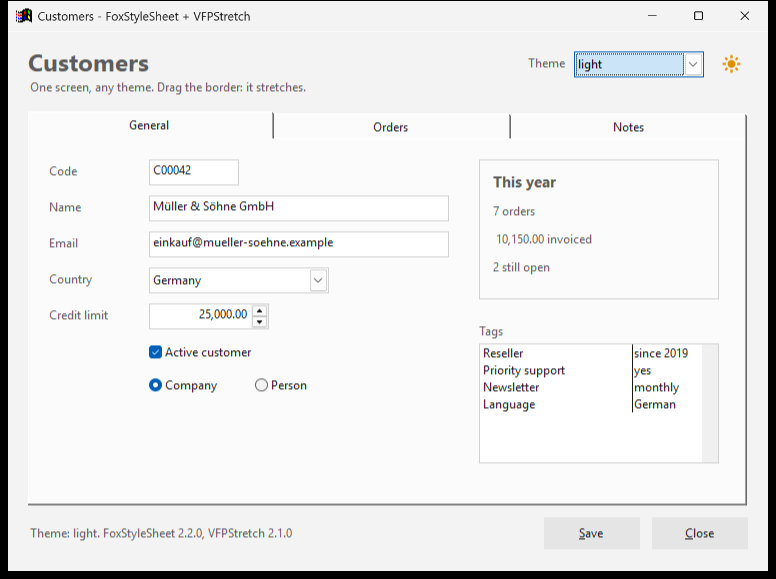
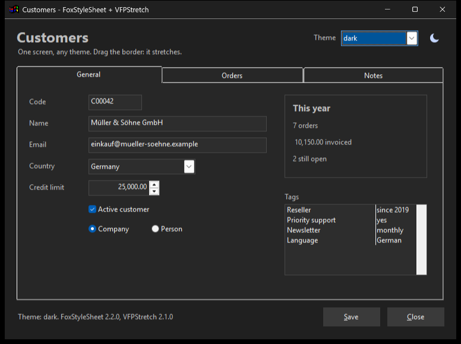

# FoxStyleSheet

Style sheets for Visual FoxPro 9 forms. A theme written like CSS (`.fss`) sets the colours,
fonts and behaviour of every control of a form in one call, without touching the form: by
base class, by your own class, by control name, and on events such as focus or mouse over.
Sixteen themes come built in, among them a light and a dark one that the user switches with
a sun and moon button. One `.prg`, no dependencies.

| `light` | `dark` |
|---|---|
|  |  |

## Install

```
foxpack add foxstylesheet
```

```foxpro
SET PROCEDURE TO foxstylesheet.prg ADDITIVE
```

Without FoxPack, copy `foxstylesheet.prg` into your project. The built-in themes are inside
the `.prg`. The Codejock title bar (`frameTheme`) is optional and needs your own Codejock
licence: see API, Codejock.

## Example

In the `Init` of a form:

```foxpro
SET PROCEDURE TO foxstylesheet.prg ADDITIVE
LOCAL loFss
loFss = CREATEOBJECT("FoxStyleSheet")
loFss.link("Word", ThisForm)
```

Or in one line, the same thing:

```foxpro
DO foxstylesheet.prg WITH "Word", ThisForm
```

The engine keeps itself alive on the form, so a `LOCAL` is enough: the event styles keep
working after `Init` ends.

### Light and dark, as Windows is

```foxpro
SET PROCEDURE TO foxstylesheet.prg ADDITIVE
ThisForm.AddObject("cmdTheme", "FssThemeToggle")
ThisForm.cmdTheme.Left = ThisForm.Width - 44
ThisForm.cmdTheme.Top = 12
ThisForm.cmdTheme.Visible = .T.

LOCAL loFss
loFss = CREATEOBJECT("FoxStyleSheet")
loFss.link(FssSystemTheme(), ThisForm)
```

`FssSystemTheme()` says whether Windows uses the light or the dark mode for applications. The
button shows a sun with the light theme and a moon with the dark one, and a click switches the
form to the other. On a top-level form (`ShowWindow = 2`) the title bar follows the theme too.

`examples\showcase` is a complete application with one screen: the two themes, the button, a
combo with every built-in theme, the choice of the user saved between runs,
[VFPStretch](https://github.com/Irwin1985/VFPStretch) to stretch it with the window, and
[GetDirPro](https://github.com/Irwin1985/GetDirPro), a folder picker in the same theme.

### A theme of your own, in a file or in a string

```css
/* my-theme.fss */
_res_ {
    accent  = rgb(43, 87, 154)
    surface = rgb(240, 243, 248)
    focus   = rgb(210, 228, 252)
    font    = "Segoe UI"
}

form {
    backColor = $surface
}

TextBox, EditBox {
    fontName  = $font
    backColor = rgb(255, 255, 255)
}

TextBox.onGotFocus {
    backColor = $focus
}

TextBox.onLostFocus {
    backColor = rgb(255, 255, 255)
}

.cmdSave {
    foreColor = $accent
    _ = this.Caption = "Save"
}

.pgf.Page1.txtCity {
    fontBold = .T.
}
```

```foxpro
loFss.link("themes\my-theme.fss", ThisForm)
```

To start from a built-in theme, `FssBuiltInTheme("light")` returns its text.

## The FSS format

A theme is a list of blocks `selector { property = value }`. Comments are `/* ... */`.

| Selector | Applies to |
|---|---|
| `form` | The form itself |
| `TextBox` | Every control whose base class **or** own class is TextBox, at any depth (subclasses included) |
| `MyTextBox` | Every control of your class MyTextBox |
| `.txtName` | The control with that name; a path reaches inside containers: `.pgf.Page1.txtCity` |
| `*` | Every control (through `SetAll`) |
| `TextBox, EditBox` | Several selectors with the same block |
| `TextBox.onGotFocus` | The same controls, when the event fires (`onLostFocus`, `onMouseEnter`, `onClick`...) |
| `.txtName.onGotFocus`, `*.onGotFocus` | A named control, or every control, when the event fires |

When several event blocks apply to a control, they run from the least to the most specific:
`*`, the base class, the own class, the name. Static blocks are applied in the order of the
file.

**Values are VFP expressions**: `rgb(43, 87, 154)`, `.T.`, `12`, `"Segoe UI"`. Each one is
evaluated with `EVALUATE()` when it is applied.

**Variables.** The `_res_` block defines them, and `$name` uses them anywhere in a value.
A variable may name another one (`borderFocus = $accent`).

**Special properties:**

| Property | Where | What it does |
|---|---|---|
| `_ = <VFP code>` | Any block | Runs the line. `this` is the control and `thisform` the form. Repeat `_` for several lines |
| `_ = $name` | Event blocks | Runs the theme function `name` (see below) |
| `icon = "sun"` | Any control with `Picture` | Draws the icon (`"sun"` or `"moon"`) in the control's `ForeColor` over its `BackColor`, sized to the control. Set those two first in the block |
| `darkTitleBar = .T.` | `form` | Windows paints the title bar dark (Windows 10 2004 and later) |
| `titleBarColor = rgb(r, g, b)` | `form` | The colour of the title bar (Windows 11); `-1` gives it back to Windows |
| `titleBarTextColor = rgb(r, g, b)` | `form` | The colour of the caption (Windows 11); `-1` gives it back to Windows |
| `picture = rgb(r, g, b)` | `page` | A solid page background, even with themed tabs |
| `frameTheme = "Word"` | `form` | The Codejock title bar with that colour scheme: `word`, `excel`, `access`, `powerpoint`, `publisher`, `onenote`, `outlook`, `red`, `gold`, `gray`, `black`, `white` |
| `editMenu = .T.` | Event blocks (`TextBox.onRightClick`) | Opens the edit menu: Undo, Redo, Cut, Copy, Paste, Paste Special, Clear, Select All |

**Functions.** `function name { ...VFP code... }` defines a block of code that an event block
runs with `_ = $name`. Inside it, `this` is the control and `thisform` is the active form.

## API

### Built-in themes

`Access`, `black`, `dark`, `Excel`, `light`, `neon`, `office-word-dark`, `office-word-light`,
`OneNote`, `Outlook`, `Powerpoint`, `Publisher`, `white`, `white2`, `windev1`, `Word`.
`FssBuiltInThemeNames()` returns them as a comma-separated list, and `FssBuiltInTheme(cName)`
returns the text of one, to start a theme of your own from it.

`light` and `dark` are twins: they set the same properties with different values, so a form
goes from one to the other and back without leftovers. Both are in Segoe UI, draw the
`FssThemeToggle` button and paint the title bar.

### FoxStyleSheet.link(cTheme, oForm)

Applies a theme to a form. `cTheme` is the name of a built-in theme (case and `.fss` do not
matter), the path of a `.fss` file, or the text of a theme. Returns `.T.` when nothing
failed. It never raises: what failed is in `nErrors`, `oErrors` and `cLastError`.

```foxpro
IF !loFss.link("themes\my-theme.fss", ThisForm)
	? loFss.cLastError
ENDIF
```

Calling `link()` again on the same engine changes the theme of a form that is already on
screen: the event styles, functions and variables of the old theme go away, and the title bar
goes back to the colours of Windows before the new theme paints it. `cTheme` keeps the theme
of the last `link()`, as it was given.

### FssThemeToggle

A `CommandButton` (32 x 32, no caption) that switches its form between two themes.

```foxpro
ThisForm.AddObject("cmdTheme", "FssThemeToggle")
* or, without SET PROCEDURE: ThisForm.NewObject("cmdTheme", "FssThemeToggle", "foxstylesheet.prg")
```

| Member | What it does |
|---|---|
| `cLightTheme`, `cDarkTheme` | The two themes, `"light"` and `"dark"` by default. Any pair works: `"office-word-light"` and `"office-word-dark"`, or two `.fss` files |
| `Click()` | Calls `Toggle()` |
| `Toggle()` | Links the other theme, with the engine already on the form or a new one, and returns its name |
| `ThemeChanged(cTheme)` | Called after every switch. Empty: bind to it with `BINDEVENT()`, or subclass, to save the choice of the user |

`light` and `dark` draw its icon. Under a theme that does not know it, it shows a moon when
the form is dark and a sun when it is light.

### FssSystemTheme()

Returns `"dark"` when Windows is set to the dark mode for applications, and `"light"`
otherwise, also on a Windows without the setting.

### FssEngineOf(oForm)

Returns the engine that `link()` hung from the form, or `.NULL.` when no theme was linked to it.

```foxpro
LOCAL loFss
loFss = FssEngineOf(ThisForm)
IF !ISNULL(loFss)
	loFss.link("dark", ThisForm)
ENDIF
```

### Errors

| Member | What it is |
|---|---|
| `nErrors` | How many errors since the last `link()` (event styles count too) |
| `oErrors` | A Collection with their messages, in order |
| `cLastError` | The last message, or `""` |
| `ClearErrors()` | Empties the three |

A property the control does not have is a warning in the log when the block is static (the
rest of the theme is applied), and an error when the block is an event block.

### Codejock: bring your own

`frameTheme` uses Codejock SkinFramework, which is commercial: FoxStyleSheet does not ship
it. If it is registered on the machine, the title bar is painted; if it is not, `frameTheme`
is skipped and everything else works. Without Codejock, `darkTitleBar` and `titleBarColor`
paint the title bar of a top-level form with what Windows itself offers.

| Property | Default |
|---|---|
| `cCodejockProgId` | `"Codejock.SkinFramework.22.1.0"` |
| `cSkinFile` | `Fss\Windows10.cjstyles` beside `foxstylesheet.prg` |
| `cCodejockOcx` | `Fss\Codejock.SkinFramework.v22.1.0.ocx` beside `foxstylesheet.prg`, registered on first use if the process runs as Administrator |
| `IsCodejockAvailable()` | `.T.` when `cCodejockProgId` is registered |

```foxpro
loFss = CREATEOBJECT("FoxStyleSheet")
loFss.cCodejockProgId = "Codejock.SkinFramework.24.0.0"
loFss.cSkinFile = "C:\MyApp\skins\Office2016.cjstyles"
loFss.link("Word", ThisForm)
```

### Other members

| Member | What it does |
|---|---|
| `cVersion` | `"2.2.0"` |
| `cTheme` | The theme of the last `link()` |
| `cPrgPath` | The folder of `foxstylesheet.prg` |
| `cPath` | `%APPDATA%\FoxStyleSheet\`: the log, the page backgrounds and the icons |
| `GetPerformanceReport()` | Styles, controls and times of the last `link()` |
| `DrawImage(cFile, nWidth, nHeight, nRed, nGreen, nBlue)` | Writes a solid-colour BMP; `.T.` or `.F.` |
| `DrawIcon(cFile, cIcon, nSize, nColor, nBackColor)` | Writes the icon `"sun"` or `"moon"` as a BMP of `nSize` x `nSize` pixels (8 to 256), with smooth edges; `.T.` or `.F.` |
| `IsDrawingAvailable()` | Always `.T.` (kept from 2.0) |
| `LogInfo/LogWarning/LogError/LogDebug(cText)` | Write to the log |

### The log

`%APPDATA%\FoxStyleSheet\FoxStyleSheet.log`, one line per warning or error:
`2026-10-03T18:30:00 | WARNING | Property 'borderColor' not found on CMDOK`. Past 1 MB it
moves to `FoxStyleSheet.old` and starts again. The `FssLogger` class has `lDebugMode` (also
the routine messages) and `nMaxLogBytes` (`0` means no cap).

## Pitfalls

- **A theme is code.** Every value goes through `EVALUATE()`, and `_` runs any VFP line.
  A `.fss` from an unknown source can do anything your application can: load only themes
  you trust.
- **A theme only changes what it names.** Switching from a theme that sets `fontBold` on a
  control to one that does not leaves it bold. Themes meant to be switched set the same
  properties, as `light` and `dark` do: if you change one, change its twin, and
  `Test_LightAndDarkSetTheSameProperties` checks it.
- **Windows draws some parts itself.** Scroll bars, the arrows of a Spinner and the button
  of a ComboBox stay light under the `dark` theme.
- **The title bar needs a window of its own.** `darkTitleBar` and `titleBarColor` work on a
  top-level form (`ShowWindow = 2`); a form inside `_Screen` keeps the frame of VFP. The
  caption colours need Windows 11.
- **`icon` takes the colours the control has when it is applied.** Put `foreColor` and
  `backColor` before `icon` in the block, and repeat `icon` in the event blocks that change
  them, as `light` and `dark` do on `FssThemeToggle.onMouseEnter`.
- **An event block changes the control, and nothing changes it back.** Pair
  `onGotFocus` with `onLostFocus`, and `onMouseEnter` with `onMouseLeave`, as the built-in
  themes do.
- **A control name that starts with "on"** at the end of a name selector reads as an event:
  `.pgf.onlineTab` means the event `lineTab`. Rename the control, or style it by class.
- **Functions run against the active form** (`_screen.ActiveForm`): fine in a real event,
  but they do nothing on a form that is not active.
- **Quote the strings.** `fontName = Arial` works by accident: `EVALUATE("Arial")` fails
  and the text is used as it is. But if a variable or a field called `Arial` exists, its
  value is used instead. Write `fontName = "Arial"`.
- **`*` without an event uses `SetAll`**: it reaches every control, including those you did
  not mean. Prefer class selectors.
- **Page backgrounds and icons are files.** They are written into `%APPDATA%\FoxStyleSheet\`
  and deleted when the engine is destroyed (when the form closes).
- **With VFPStretch, link the theme first.** A theme can set sizes (`headerHeight` of a grid);
  VFPStretch has to take the form after that, and stretch it again after a switch, as the
  showcase does.

## Built-in themes from the .fss files

The `themes\*.fss` files are the source of the built-in themes. After changing one, run
`tools\build-themes.ps1`: it writes them into the region at the end of `foxstylesheet.prg`.
A test checks that the two say the same.

## Tests

From the repository folder:

```
foxproof run --prg tests\FoxStyleSheetTests.prg
foxproof run --prg tests\FoxStyleSheetRegressionTests.prg
foxproof run --prg tests\FoxStyleSheetThemeTests.prg
```

## History

- **2.2.0** (2026-10-15). The `light` and `dark` themes, `FssThemeToggle` with its sun and
  moon, and `FssSystemTheme()`. A second `link()` changes the theme of a form on screen
  without leftovers. The `icon` property and `DrawIcon()`. The title bar without Codejock:
  `darkTitleBar`, `titleBarColor`, `titleBarTextColor`. `cTheme` and `FssEngineOf()`. A
  showcase application in `examples\showcase`. MIT license.
- **2.1.0** (2026-10-03). Built-in themes inside the `.prg`, a parser of its own without
  `VBScript.RegExp`, page backgrounds without `System.app`, Codejock optional.
- **2.0.0** (2026-05-09). Selectors by class, name and event.

## License

MIT. See [LICENSE](LICENSE).
